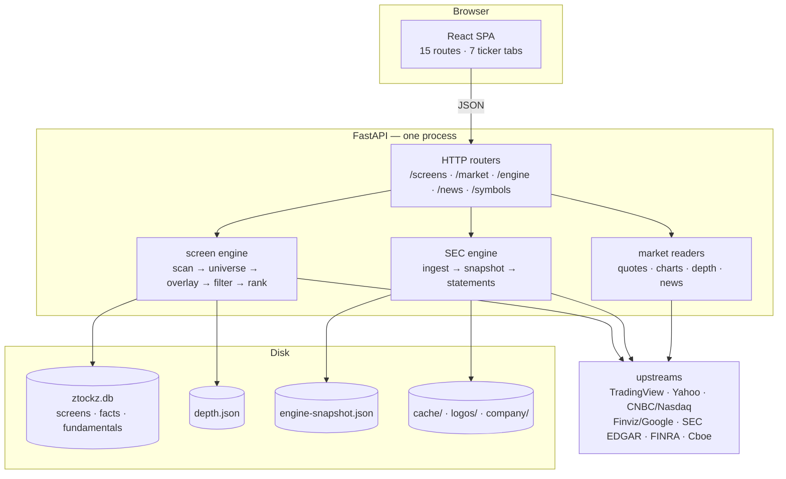
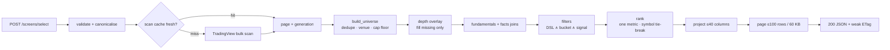
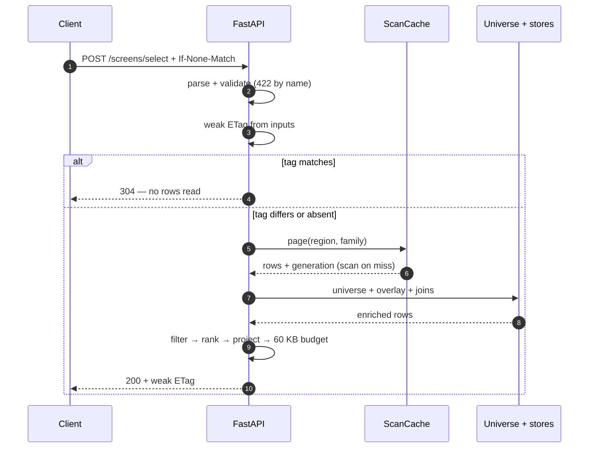

# Ztockz

A keyless, US-equity-first screener with a free core and a seven-tab ticker page, built on one rule: every cell is an observation, arithmetic over observations, or an explicit absence — never a fabricated zero.

```text
+----------------------------------------------------------------------+
| universe   5,715 US listings -> 5,576 issuers after dedupe           |
| surface    62 JSON endpoints - 15 SPA routes - 7 ticker tabs         |
| catalogue  116 frozen columns - 40 per panel - 9 views               |
| buckets    1,416 ids (1,328 live) - 82 filter keys - 27 signals      |
| tests      5,495 pytest tests / 224 files - 134 web test files       |
| stack      Python 3.14 - FastAPI 0.159 - SQLite - React 19 - Vite 7  |
+----------------------------------------------------------------------+
```

Counts are taken from the committed tree at `5ba8b64` (2 Nov 2026): endpoints from `app.openapi()`, tests from `pytest --collect-only`, catalogue and bucket counts from the registries at import. They are measurements, not estimates.

## Run it

```bash
python3.14 -m venv .venv
.venv/bin/pip install -r requirements.txt
.venv/bin/pip install -e ".[dev]"

cd web && npm ci && npm run build && cd ..
.venv/bin/uvicorn app.main:app --host 0.0.0.0 --port 8080
```

Open <http://localhost:8080>. The engine starts empty on purpose; the screener needs no dataset, but the SEC statements do. Build one with:

```bash
.venv/bin/python -m app.engine.bootstrap \
  --symbols AAPL,MSFT,NVDA --output data/engine-snapshot.json
```

or point `MEE_ENGINE_SNAPSHOT` at an existing file. To load a snapshot built on a bare host, export `MEE_ENGINE_SNAPSHOT=data/engine-snapshot.json` before starting uvicorn; the container image sets that path for you. Without one, `/engine/health` says the dataset is absent and the statement routes answer `503 screen_unavailable` — not an empty table.

## What this is

Ztockz is a single-process web application for screening US equities and reading one ticker in depth. The browser is a React SPA; the server is FastAPI; state is one SQLite file plus a handful of atomically written JSON stores. There is no queue, no Redis, no worker fleet and no account system.

Two generations live in the tree, and a reader should know which is which:

- **The product surface** — `/screens` (browse, select, export), `/market` (home, map, signals, quotes, chart, news, breadth) and the `/engine` reads the ticker page uses, serving the SPA in `web/`.
- **The original engine** — the contract-first market-data enrichment pipeline, still named **MEE** in every environment variable. It remains mounted at `/markets`, `/requests`, `/providers` and `/sources`, with its own job repository, quote CAS, provider ladder, 92-column export writer and verification rules. It is maintained, not dead, but it is not where new product work goes.

The env prefix is `MEE_` because of that history. Renaming it would break every deployment for no product gain.

Data is scrape-first and keyless by default: a TradingView bulk scan supplies the universe; Yahoo, CNBC, Nasdaq, Finviz and Google verify or deepen it; SEC supplies filings and statements; FINRA and Cboe supply short interest and optionability. No API key is required for that path, and each source is a module at the edge, so replacing one is a code change rather than a data migration.

| It is | It is not |
|---|---|
| A keyless screener over ~5,600 US issuers | A real-time market feed |
| A seven-tab ticker page with SEC XBRL statements | A broker: no orders, no IBKR; portfolio is typed by hand |
| One FastAPI process, SQLite and JSON stores | A distributed system; no Redis, queue or worker tier |
| Source-per-cell, with a reason when a cell is absent | A vendor warehouse; statements are SEC-only |
| Free core: screen, sort, export, presets | A paywall on the core screen |
| Source-available: no root licence, `web/` UNLICENSED | Open source |
| Delayed public quotes, labelled where shown | An options surface: no option-chain source is configured |

Five features are tier-gated by policy, not by missing code: after-hours close, after-hours change, news keyword search, ETF held-by and trade count. The gate is `app/screen/data/entitlements.json` (`free` or `premium`), re-read on change without a restart. A caller's plan comes from a recognised `X-Api-Key` fingerprint, else an explicit `X-Plan` declaration. There is no billing system behind the declaration.

### The rule that shapes the code

Every number is one of three things:

1. **An observation** from a named upstream, copied verbatim.
2. **Arithmetic over observations**, with the formula in one module and a unit on the response.
3. **Absent**, with a machine-readable reason and a human sentence.

This is enforced in the seams, not in a style guide:

- The depth overlay fills a row's **missing** keys only. Presence is the test, not truthiness, so a real `0.0`, `False` or `""` is never overwritten.
- A statement line with no XBRL row is `null` with `status="not_reported"`; a flow row must be 330–400 days long to fill an annual column, so a quarter is never printed as a year.
- A failed home-page block is `null` **and** named in `unavailable[]`; `[]` would claim "nobody matched" and a client could not tell the difference.
- An unknown bucket token is `422 unknown_bucket` naming the ids that would have worked. An unavailable signal is `422 unavailable_signal` naming the metric it needs. A refused control never returns an empty page.

## Architecture



| Layer | Modules | Responsibility |
|---|---|---|
| HTTP | `app/api/*` | Parse, validate, map domain errors to `{error, errorMessage}`. No business rules. |
| Screen engine | `app/screen/*` | Scan, universe build, depth overlay, fundamentals/facts joins, filters, ranking, views, export. |
| SEC engine | `app/engine/*` | EDGAR ingest, checksummed snapshot, facts, statements, 116-key catalogue. |
| Market readers | `app/market/*` | Quotes, depth collection, charts, company profiles, venues, news. |
| Persistence | `ztockz.db` + JSON | Screen snapshots, facts, fundamentals, depth, quotes, engine snapshot. |
| SPA | `web/src/*` | 15 shell routes, screener grid, charts, ticker page, local watchlist/portfolio. |

One process is deliberate. The scan cache is process-local, the SQLite connection pool is `NullPool`, and the background collectors (`MEE_DEPTH`, `MEE_QUOTE_HUB`) are opt-in. A second process can run against the same SQLite file under WAL, but each gets its own scan cache and the writers serialise; there is no shared cache tier.

## Data pipeline



### Request lifecycle

`POST /screens/select` is where the caching rules actually pay: the tag is decided before the answer, so a revalidation costs neither a scan nor a join.



| Stage | What happens | Number |
|---|---|---|
| Scan | One TradingView `POST /america/scan`; rows keep the provider's field names. A 200 + HTML bot wall is a terminal `ScanBlocked`, not a parse error. | 5,715 listings |
| Universe | Issuer dedupe, venue priority (US first), family gate (`stock`/`etf`), cap floor. Browse keeps the USD 100M floor; `select` drops it to 0 to address the whole market. | 5,576 issuers |
| Overlay | `data/depth.json` fills **missing** catalogue cells. It may supply 106 of 116 keys; a key the catalogue does not declare is dropped at the boundary. | daily store |
| Joins | `fundamentals_snapshots` supplies forward P/E, P/S and payout ratio; two ratio cells are computed from those inputs. `screen_facts` supplies short float, insider and institutional ownership. | SQLite |
| Derived | Ten scan metrics (EMA/SMA, momentum) exposed under stable names; no value is recomputed on this side. | 10 columns |
| Filter | Three layers, described below. | 82 keys |
| Rank | One visible metric, `<field>` descending or `-<field>` ascending; nulls last in both directions; ties break on `symbol`. | no composite score |
| Project | Column cap and response budget; truncation is reported in `budget`. | 40 columns / 60 KB |

### Per-symbol reads

The screener answers "which rows?"; these answer "tell me about this one":

| Endpoint | Returns | Source |
|---|---|---|
| `GET /engine/snapshot/{symbol}` | 84-cell snapshot with a unit per key | scan row + depth overlay |
| `GET /engine/statements/{symbol}` | 10 annual + 8 quarterly periods, three statements, TTM | cached SEC `companyfacts` |
| `GET /engine/technicals/{symbol}` | SMA/EMA, RSI, ATR, returns incl. WTD/MTD | Yahoo daily bars via `/market/chart` |
| `GET /engine/risk/{symbol}` | alpha, beta, correlation, R², volatility, Sharpe, max drawdown vs a benchmark | daily bars via the chart reader |
| `GET /engine/profile/{symbol}` | header quote, identity, 52-week and beta | scan row + depth |
| `GET /engine/peers/{symbol}` | same sector, nearest market cap | scan rows |
| `GET /engine/insider/{symbol}` | Form 4 rows | SEC filings |
| `GET /news/{symbol}` | headlines, 15-minute document cache | Google News RSS + GDELT |
| `GET /market/chart/{symbol}` | OHLC bars, 5-minute cache | Yahoo chart v8 |
| `GET /engine/options/{symbol}` | **not wired** — see the limits | — |

## The screener engine

### Three filter layers

They look similar on the wire and compile differently on purpose.

| Layer | Wire shape | Compiler | Refusal |
|---|---|---|---|
| DSL | `{"field": "pe_ttm", "op": "lt", "value": 15}` | `app.screen.filters.compile_filter` | `422` naming the field, operator or type |
| Bucket | `{"key": "sh_price", "op": "eq", "value": "price:u5"}` | `app.screen.buckets.bucket` | `422 unknown_bucket` / `unavailable_bucket` |
| Signal | `"signal": "top-gainers"` | `app.screen.descriptive.signal` | `422 unknown_signal` / `unavailable_signal` |

A bucket token is a criterion with **no field**: the request carries `field=None`, which is what selects the bucket compiler instead of the DSL. Buckets exist because Finviz's panels offer names, not ranges — `cap:mega`, `earn:todaybefore`, `targetprice:a50`, `idx:sp500`, `rsi:ob70`. These shapes do not fit one `field op value` triple: a direction (`gap:u0`), a distance from a level (`highlow52w:nh`), a comparison between two cells (`epsrev:bp`), a clock (`earn:today`) or set membership (`idx:sp500`).

Counts, from the registry at import time:

- **82** Finviz filter keys, addressed by either the Finviz key or a catalogue column (`pe` resolves to `pe_ttm`).
- **1,416** bucket ids in **67** families; **1,328** are available and the rest carry a reason.
- **27** signals; **10** are computable over scan cells, the other 17 name the metric they need.

A signal is a **population and its own measure**, not another predicate. `top-gainers` means "positive change, highest first". An explicit `sort` always wins; without one, the signal supplies the order. That is why `signal` is top-level, outside `criteria`.

Unknown is not zero here too: a null cell matches **no** bucket. A dividend yield nobody reported matches neither `none` (0%) nor `pos`; a percentage bucket whose two inputs are missing matches nothing rather than dividing by zero.

### The page is bounded

- **100 rows** per selection (`PANEL_LIMIT`). A larger `limit` is clamped, not rejected, and the applied limit is echoed.
- **40 columns** per request (`COLUMN_LIMIT`). "All columns" in the UI is three requests of ≤40.
- **60,000 bytes** per response (`PANEL_BUDGET_BYTES`). A body that has to shrink carries a `budget` object: bytes shipped, whether it truncated, which fields went, how many tail rows were cut.
- **Stable order**. `rank_rows` orders by the metric and breaks ties on `symbol`; page N and page N+1 cannot contain the same issuer because the provider reshuffled equal values.
- **Nulls last**, ascending or descending. A missing market cap is not a small company.

The two routes report their counts under deliberately different names: browse says `matched`, select says `total`; both carry `universe_total`. A 5-row page must not be read as a 5-stock market.

### Two validators, chosen by cost

| Route | ETag | Why |
|---|---|---|
| `GET /screens` | none | 20-row display; no validator is published |
| `GET /screens/filters` | strong, over the body | built from memory, no scan |
| `POST /screens/select` | **weak**, over the inputs | hashing the answer would cost the answer |
| `GET /market/chart/{symbol}` | over symbol/range/interval + 5-minute epoch | must decide a `304` before any fetch |

For `/screens/select` the tag is computed **before** the answer exists: the canonical request, the scan page's generation, the depth store's file identity, the fundamentals/facts store row counts and newest stamps, and the brand-asset directory. A matching `If-None-Match` is answered `304` without a scan, a universe build or a join. A store that cannot describe its own revision gets a unique token instead, so the route pays a `200` rather than certify a body it never read. `as_of` is deliberately excluded: it is the read moment, and a tag that moved with the clock would never match.

The scan itself is cached for a short TTL, single-flight, keyed by the provider question (`region` + family + columns). The cache holds the **scan**, never the answer. `X-Scan-Cache` says `hit`, `miss` or `shared`.

### The 116-column catalogue

`app/engine/data/finviz_columns_116.json` is the frozen vocabulary: 116 keys, in catalogue order, each with a label and unit. It is not a suggestion. `app/screen/columns.py` maps every key to the row field that answers it; `app/screen/views.py` partitions all 116 exactly once across nine views plus detail-only:

| View | Columns | Question |
|---|---:|---|
| Today | 11 | What moved? |
| Value | 13 | What is cheap? |
| Quality | 12 | Is the business good? |
| Growth | 12 | Is it growing? |
| Momentum | 10 | Is it working? |
| Trend | 12 | Where is it relative to its averages? |
| Ownership | 10 | Who holds it? |
| Income | 8 | What does it pay? |
| Profile | 12 | What is it? |
| *Detail-only* | *16* | *prose, URLs, identity — never a column* |

That is 100 + 16 = 116, and the partition is enforced at import: an unknown key, a duplicate or an orphan fails the process. `all` is not a hand-written list; it is the catalogue in catalogue order, so it cannot drift.

Some absences are decisions, recorded in `ABSENT_COLUMNS` with a reason:

- **MTD** is not a screener column. The provider has no month-to-date field; `Perf.1M` is a trailing one-month return, and labelling it MTD would be a false statement about the window. `perf_mtd` exists only in technicals, where it is computed from daily closes against the first trading day of the month.
- **Greeks, expiry and DTM** are properties of one option contract, not an issuer row. A single `iv` or `dtm` cell would silently choose a strike and expiry nobody asked for. They belong on the per-symbol options surface and never in the bulk grid.

### Export

`POST /screens/{id}/export` writes a bundle for `top20` or `all`, in `csv`, `xlsx`, `jsonl` and `parquet`, plus a manifest that hashes every artefact. The `all` scope rescans on demand; it does not read the 20 displayed rows from `screen_rows` and call them the market.

## The ticker page

`/stock/{symbol}` is one page with seven tabs. The tab is in the query string (`?tab=statements`), so Back, reload and a shared link land on the same section.

| Tab | Draws | Read |
|---|---|---|
| Overview | header, chart, 84-cell snapshot, technicals and risk, peers, held-by, insider, news | several, each independent |
| Statements | income, balance, cash flow, 10 annual + 8 quarterly, TTM | `GET /engine/statements/{symbol}` |
| Ownership | short float, insider and institutional ownership | `POST /screens/select` in `symbols` mode |
| Insider | Form 4 rows | `GET /engine/insider/{symbol}` |
| Filings | the Form 4 documents the engine reads | `GET /engine/insider/{symbol}` |
| News | headlines in full | `GET /news/{symbol}` |
| Chart | OHLC bars at a taller height | `GET /market/chart/{symbol}` |

**Statements** come from SEC XBRL, read from the cached `companyfacts` document the ingest pass already wrote — the route never fetches. Only 10-K filings create an annual column and only 10-Qs create a quarterly one; a fiscal Q4 is not invented from a full-year row. A line with no row is `null` + `not_reported`, and provenance is `(us-gaap tag, accession)` so a cell can be traced to one document. TTM is `latest annual + YTD now − YTD a year earlier`, not "sum the last four quarters" — the fourth quarter does not exist as a 10-Q.

**The snapshot** is 84 cells in one read, each with a unit from a closed vocabulary: `ratio`, `percent`, `usd`, `count`, `bool`. That is deliberate: `debt_to_equity` arrives as `0.7844` and is rendered as `78.44%` once, in one place, rather than formatted three ways on three surfaces.

**Technicals** use one daily close series. `as_of` is the last bar's date, not the request moment. A window the series cannot fill is `null` and named in `missing` — never `0`. WTD and MTD are calendar returns anchored to the close before the week's Monday / month's first day, so a holiday-shortened week is not silently five bars.

**Risk** is computed from daily returns aligned on common dates against `^GSPC`: alpha, beta, correlation, R², volatility, Sharpe and max drawdown. It reads the same chart series and five-minute cache as the chart, so drawing the chart has already paid for the risk numbers; fewer than 60 common returns is `422 insufficient_history`, because a month of beta is an anecdote.

**Delayed is a label, not a footnote.** The home index strip says `Delayed` once; Nasdaq is a per-symbol fallback delayed 15 minutes. Nothing on this surface is real-time.

**One known hole in this surface**, stated here rather than discovered in production: there is no Options tab. The plan is explicit that options wait for an option-chain source. `GET /engine/options/{symbol}` is in the route table, but its implementation imports `app.market.options`, which is not in the tree, so it cannot serve. `/market/instruments` reports greeks, expiry and DTM as unavailable, once, in `unavailable[]`.

## Workflow

The repository is built test-first, in small commits, often by several agents in parallel. The working agreement is short enough to state.

### RED first

1. **RED** — write the failing test, run it, and record the failure for the right reason (not an import error pretending to be an assertion).
2. **GREEN** — the smallest implementation that makes it pass. No unrelated edits in the same step.
3. **REFACTOR** — only with the test green; the public shape does not move.

Never edit a test to make it pass. The suite is the contract; when a test is wrong, the change to the test is its own commit with the reason.

### Gates

```bash
.venv/bin/pytest
cd web && npm run check
.venv/bin/python -m app.engine.ops smoke --base-url http://127.0.0.1:8080
```

`npm run check` is the whole front-end gate: Vitest, `tsc --noEmit`, a Vite build, a token audit and the 180 KB initial-JS budget. `npm run budget` measures gzip -9 of the entry and every `modulepreload` chunk; a lazy chunk is not counted, because the gate exists to protect first paint, not to punish code splitting. The Docker `web` stage runs the same `npm run check`, so a broken shell fails the image build rather than the first request.

### Commits

- The subject is a sentence about the change, not a prefix: "Sector stops being a dead control", not `fix(screen): sector`.
- The body says what was verified and what was not. If a claim was measured, say where; if it was not, do not imply it.
- One idea per commit. A plan and its implementation are two commits. A behaviour change and a rename are two commits.
- The integrator reruns the full gate before committing. A flaky test is a red test, not a retry.

### Parallel work

- **One owner per file set.** Two builders never edit the same module; shared files (schemas, response shapes, the 116-key catalogue) are changed by the parent first, in their own commit.
- **Contract before implementation.** The request/response document, the refusal codes and the fixture land before the code that satisfies them, so builders can work against a stable shape.
- **API before UI.** The interface is built last, against a frozen endpoint. A UI change that needs a new field is a contract change, not a silent client-side derivation.
- **Disjoint verification.** Each builder runs its own tests; the parent runs the full gate. A builder does not merge another builder's work.

### The refusal rule

An unavailable control answers with a code and a sentence, never an empty result. This is the single most repeated product decision in the codebase:

- `422 unknown_bucket` lists the ids that would have worked.
- `422 unavailable_signal` names the metric the signal needs.
- Theme and Sub-theme are published disabled with the reason (no taxonomy), not as empty pickers.
- `/engine/statements` answers `404 no_statements` for "this registrant files nothing" and `503 screen_unavailable` for "nothing was ingested". Different facts, different codes.
- A failed home block is `null` and named in `unavailable[]`; a failed symbol in a block joins under its own name (`index:^VIX`) while the rest of the block still publishes.

## Operations

One uvicorn process on **8080**. No other port is opened. Docker Compose is the reference runtime:

```bash
docker compose up -d --build     # engine on :8080, volume ztockz-data:/data
docker compose run --rm ops smoke --base-url http://engine:8080
docker compose run --rm ops backup --keep 7
```

The container healthcheck is not `/health`'s overall verdict: it asserts that `/health` answers and that `/app` returns the shell. A snapshot-less container is a documented state; an image without its built shell is a broken image.

### Probes

| Route | Scope | Cost |
|---|---|---|
| `GET /health` | deployment: depth store, snapshot, enrichment cursors, free space, screen DB | stat + one SQLite count; snapshot digest memoised per file identity |
| `GET /health/deep` | three upstreams | bounded per probe and in total; never called by a load balancer |
| `GET /engine/health` | the SEC dataset and startup errors | in-memory |

`/health` returns `200` for a stale-but-serving deployment and `503` only for fatal data (a digest that does not verify, a store that cannot be read). That distinction is deliberate: a load balancer must not remove a box that can still answer.

### systemd

`deploy/` ships three oneshot units and timers — backup, cache retention, daily canary — not an application unit. They assume code at `/opt/ztockz`, environment at `/etc/ztockz/engine.env`, state at `/var/lib/ztockz` and a `ztockz` system user. The app itself runs under uvicorn or the container; the timers are the alternative to a scheduler.

### Data layout

| Path | Default | Contents |
|---|---|---|
| `MEE_DB_PATH` | `./ztockz.db` | SQLite: `screens`, `screen_rows`, `fundamentals_snapshots`, `screen_facts`, plus the legacy job/quote tables |
| `MEE_ENGINE_SNAPSHOT` | `$MEE_DATA_DIR/engine-snapshot.json` | checksummed SEC dataset (`schema_version`, `checksum`, `dataset`) |
| `MEE_ENGINE_CACHE_DIR` | `$MEE_DATA_DIR/cache` | one `companyfacts` document per CIK |
| `MEE_DEPTH_STORE_PATH` | `data/depth.json` | per-field depth store, atomic write once per cycle |
| `MEE_QUOTE_STORE_PATH` | `data/quotes.json` | quote-hub latest-value snapshot |
| `MEE_EXPORT_DIR` | `out` | screen export bundles and manifests |
| `<data>/logos` | `$MEE_DATA_DIR/logos` | brand marks, filled by `scripts/logos-backfill.py` |
| `<data>/company` | `$MEE_DATA_DIR/company` | seven-day Yahoo company-profile cache |
| `$MEE_DATA_DIR/backups` | `$MEE_DATA_DIR/backups` | `ops backup` destination |

Note the two families: the **engine** paths resolve through `MEE_DATA_DIR`, while the quote and depth stores default to `data/*.json` **relative to the working directory**. The container sets the engine, database and export paths explicitly, so those land under `/data`; the depth and quote stores still follow their own defaults unless `MEE_DEPTH_STORE_PATH` and `MEE_QUOTE_STORE_PATH` are set. On a host that moves the data root, set both.

SQLite runs `journal_mode=WAL`, `busy_timeout=5000` and `foreign_keys=ON` on every connection. Migrations are Alembic (`0001`–`0005`); the app never calls `create_all`, because a second schema definition drifts silently.

### Environment

| Variable | Default | Purpose |
|---|---|---|
| `MEE_DATA_DIR` | `./data` | root for engine cache, snapshot and backups |
| `MEE_DB_PATH` | `./ztockz.db` | SQLite database |
| `MEE_EXPORT_DIR` | `out` | export bundle root |
| `MEE_ENGINE_SNAPSHOT` | `<data>/engine-snapshot.json` | dataset loaded at startup; a failed load is reported, not replaced by an EDGAR fetch |
| `MEE_ENGINE_CACHE_DIR` | `<data>/cache` | SEC document cache |
| `MEE_ENGINE_SYMBOLS` | empty | ingest these tickers at startup when no snapshot exists |
| `MEE_SEC_RATE_LIMIT` | `10` | shared SEC requests/second (`0` disables) |
| `MEE_SCREEN_DEPTH` | `true` | overlay `depth.json` onto screen rows |
| `MEE_SCREEN_MULTI_SOURCE` | `true` | median consensus over TradingView + live verifiers |
| `MEE_DEPTH` | `false` | start the daily depth collector |
| `MEE_DEPTH_STORE_PATH` | `data/depth.json` | depth store the collector writes and the screener reads |
| `MEE_QUOTE_HUB` | `false` | start the free/premium quote loops |
| `MEE_SERVE_UI` | auto | `1` requires `web/dist`; `0` serves API only; unset infers from the tree |
| `MEE_ENGINE_PUBLIC_MODE` | off | licence policy for dataset-backed engine routes |
| `MEE_ENRICH_API_KEY` | unset | require `X-Enrich-Key` on `POST /market/enrich`; unset = open |
| `MEE_COINIDS_PATH` | `/home/ubuntu/ztockz-data/coinid.json` | instrument manifest; **the default is a host path, set this in any deployment** |
| `MEE_LOG_LEVEL` | `INFO` | level for the `mee` logger tree |
| `MEE_STRICT_ENV` | off | refuse to start on an unknown `MEE_*` variable instead of warning |

`check_startup()` reports a misspelled `MEE_*` variable at boot, because pydantic-settings ignores unknown keys in silence. That guard exists after a real incident: `MEE_DEPTH_UNIVERSE` sat next to `MEE_DEPTH_UNIVERSE_PATH`, the collector ran on its default universe, and the store looked healthy with the wrong 10,429 symbols.

## Project layout

```text
app/
  api/           HTTP surface: validation, envelopes, route wiring
  screen/        screener engine: scan, universe, filters, buckets, views, export
  market/        readers and collectors: quotes, depth, chart, company, news, venues
  engine/        SEC ingest, checksummed snapshot, facts and statements
  fundamentals/ 24-hour fundamentals snapshot store
  news/          headlines (Google News RSS + GDELT), 15-minute document cache
  ops/           canary, alerting and retention/backup commands
  branding/      logo resolution and monogram fallback
  sources/       static source graph and capability documents
  export/        legacy streaming export (csv, json, jsonl, xlsx, parquet)
  jobs/          legacy job repository, single-use quote store
  providers/     legacy provider registry, ladder, budget, HTTP seam
  resolve/       legacy symbol resolution and reference master
  verify/        legacy 92-column verification rules
  worker/        legacy in-process job runner
web/             React 19 SPA (Vite, Tailwind, TanStack Table, lightweight-charts)
ui/              pre-cutover vanilla cockpit, served at /ui
alembic/         five migrations; the only schema source
schemas/         published JSON Schemas (screen, selection, instruments, sources)
deploy/          systemd timers for backup, retention and canary
scripts/         probe, backfill and research scripts; not runtime
tests/           224 files, 5,495 collected tests
data/            runtime logos and default store locations (gitignored)
exports/         generated export bundles (gitignored)
evidence/        phase gate transcripts, kept as history
research/        upstream research notes and captures
reference/       venue master and static reference data
```

## Limits and next steps

Honest list. None of these is a bug report; each is a known boundary with a reason.

1. **Options are not shipped.** No option-chain source is configured. The tab does not exist, the route is not wired, and `/market/instruments` says so in `unavailable[]`. The plan defers it until a source exists; greeks, expiry and DTM stay per-symbol and never become screener columns.
2. **No theme taxonomy.** Theme and Sub-theme are disabled controls with a reason, not empty pickers. A real implementation needs a licensed classification or an editorial map; neither is in the tree.
3. **No bar store for chart patterns.** Technicals and risk fetch a one-year daily series on demand (cached five minutes); there is no stored 20-day bar series, so support/resistance, double tops and the chart-pattern signals are unavailable by fact.
4. **MTD is technicals-only.** The screener catalogue has no month-to-date key because no provider field measures it. Do not add a column that relabels a trailing month.
5. **No broker integration.** IBKR is a named capability with no configuration. The portfolio is a browser-local list the reader types; there are no positions, fills or account data.
6. **One scan upstream.** The screener's universe comes from TradingView. A bot wall is terminal and the route serves a stale snapshot or fails honestly; there is no second scan provider.
7. **Statements are SEC-only.** Identity and XBRL statements cover SEC registrants; the Global tab screens prices and metrics, not statements.
8. **SQLite, not Postgres.** A Postgres migration plan exists; today the deployment is single-node and the SQLite writer is the serialisation point.
9. **No accounts.** Watchlist and portfolio live in `localStorage`; two browsers are two products. There is no server-side user, sync or sharing.

## Credits and licences

- **lightweight-charts 5.2.1** — Apache-2.0. The licence and NOTICE are in `web/legal/lightweight-charts-LICENSE.txt` and `web/legal/lightweight-charts-NOTICE.txt`; attribution is also in `web/NOTICE.md`.
- **shadcn/ui** — MIT. Files under `web/src/components/ui/` are vendored from a pinned commit; each file header records the source URL and commit. The licence text is in `web/NOTICE.md`.
- **Upstream data** — TradingView (bulk scan), Yahoo Finance (chart, quoteSummary, fundamentals-timeseries), CNBC (batch quote), Nasdaq (fallback/verification, 15-minute delay), Finviz (snapshot, depth and facts pages), Google Finance (verification), SEC EDGAR (`companyfacts`, `submissions`, quarterly bulk financial statements), FINRA (consolidated short interest), Cboe (delayed optionable list), SSGA, iShares and Nasdaq (index membership), Google News RSS and GDELT (headlines).
- **No root licence.** There is no `LICENSE` at the repository root and `web/package.json` marks the SPA `UNLICENSED`. Treat the code as source-available, not open source, until a licence is added. The upstream data remains subject to each provider's terms; a scraper is not a licence.
