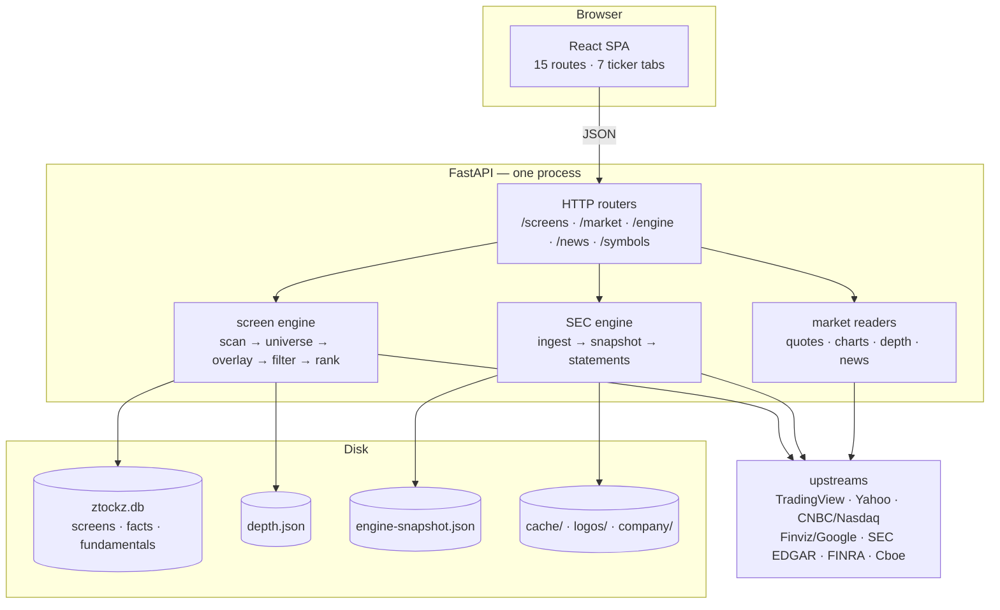
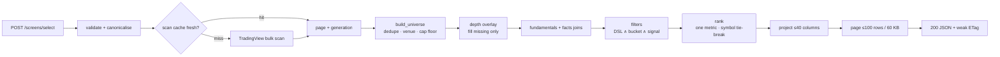
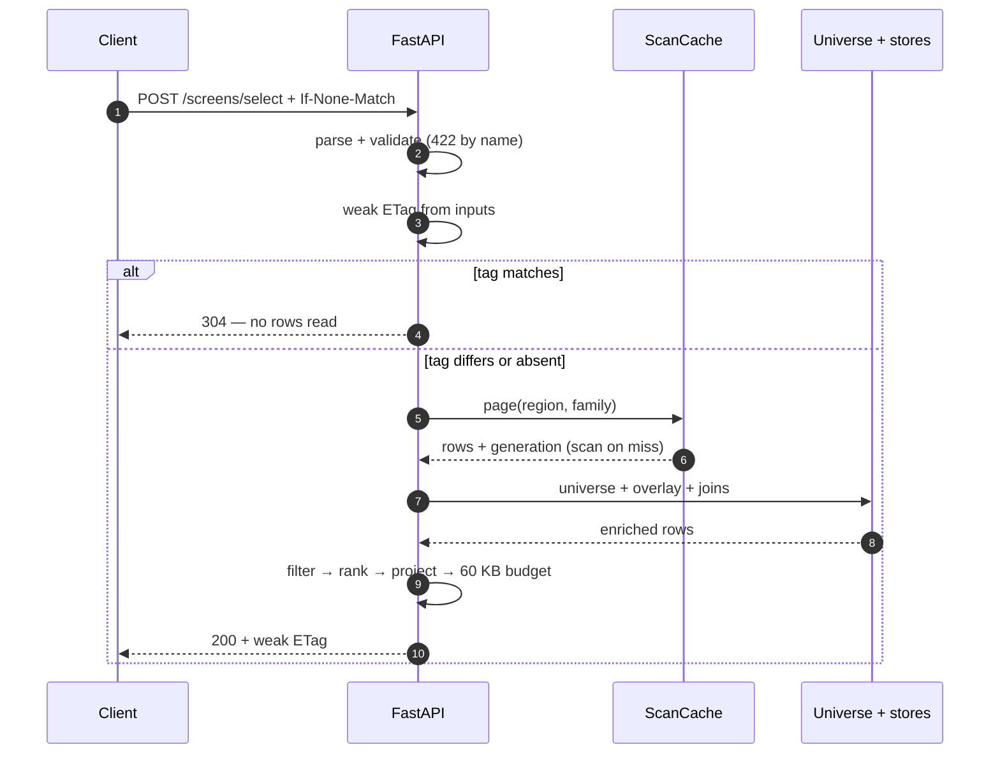

<p align="center">
  
</p>

<h1 align="center">Signal Research</h1>
<p align="center">
  <em>Free market research across US equities, ETFs, crypto, futures & forex.<br/>One dashboard. No account required.</em>
</p>

<p align="center">
  
  
  
  
  
  
</p>

---

Signal Research is a single-process market research platform: a keyless screener over ~5,600 US issuers, a seven-tab ticker page with SEC XBRL statements, and a React SPA shell. No Redis, no queue, no worker fleet, no accounts.

Every cell is one of three things: an **observation** from a named upstream, **arithmetic over observations** with the formula in one module, or an **explicit absence** with a machine-readable reason. Zero is never fabricated.

```text
universe   5,715 US listings → 5,576 issuers after dedupe
surface    62 JSON endpoints · 15 SPA routes · 7 ticker tabs
catalogue  116 frozen columns · 40 per panel · 9 views
buckets    1,416 ids (1,328 live) · 82 filter keys · 27 signals
tests      5,495 pytest tests / 224 files · 134 web test files
stack      Python 3.14 · FastAPI 0.159 · SQLite · React 19 · Vite 7
```

Counts are measurements from the committed tree, not estimates.

## Quick start

```bash
python3.14 -m venv .venv
.venv/bin/pip install -r requirements.txt
.venv/bin/pip install -e ".[dev]"

cd web && npm ci && npm run build && cd ..
.venv/bin/uvicorn app.main:app --host 0.0.0.0 --port 8080
```

Open http://localhost:8080. The screener needs no dataset, but SEC statements do:

```bash
.venv/bin/python -m app.engine.bootstrap \
  --symbols AAPL,MSFT,NVDA --output data/engine-snapshot.json
```

Set `MEE_ENGINE_SNAPSHOT=data/engine-snapshot.json` before starting uvicorn. Without a snapshot, `/engine/health` reports the dataset absent and statement routes answer `503 screen_unavailable` — never an empty table.

## What this is

Two generations live in the tree:

- **The product surface** — `/screens` (browse, select, export), `/market` (home, map, signals, quotes, chart, news, breadth), and the `/engine` routes the ticker page reads, serving the SPA in `web/`.
- **The original engine** — the contract-first market-data enrichment pipeline, still named **MEE** in every environment variable. Mounted at `/markets`, `/requests`, `/providers` and `/sources`, with its own job repository, quote CAS, provider ladder, and 92-column verification rules. Maintained, not dead, but not where new product work goes.

The env prefix is `MEE_` because of that history. Renaming it would break every deployment for no product gain.

Data is scrape-first and keyless by default: TradingView supplies the universe; Yahoo, CNBC, Nasdaq, Finviz and Google verify or deepen it; SEC supplies filings and statements; FINRA and Cboe supply short interest and optionability. No API key is required for that path. Each source is a module at the edge, so replacing one is a code change rather than a data migration.

| It is | It is not |
|---|---|
| A keyless screener over ~5,600 US issuers | A real-time market feed |
| A seven-tab ticker page with SEC XBRL statements | A broker: no orders, no IBKR; portfolio is typed by hand |
| One FastAPI process, SQLite and JSON stores | A distributed system; no Redis, queue or worker tier |
| Source-per-cell, with a reason when a cell is absent | A vendor warehouse; statements are SEC-only |
| Free core: screen, sort, export, presets | A paywall on the core screen |
| Source-available: no root licence, `web/` UNLICENSED | Open source |
| Delayed public quotes, labelled where shown | An options surface: no option-chain source is configured |

Five features are tier-gated by policy, not by missing code: after-hours close, after-hours change, news keyword search, ETF held-by and trade count. The gate is `app/screen/data/entitlements.json` (`free` or `premium`), re-read on change without a restart. There is no billing system behind the declaration.

### The rule that shapes the code

Every number is one of three things:

1. **An observation** from a named upstream, copied verbatim.
2. **Arithmetic over observations**, with the formula in one module and a unit on the response.
3. **Absent**, with a machine-readable reason and a human sentence.

Enforced in the seams, not in a style guide: the depth overlay fills a row's **missing** keys only; a real `0.0`, `False` or `""` is never overwritten. A failed home-page block is `null` **and** named in `unavailable[]`. An unknown bucket token is `422 unknown_bucket` naming the ids that would have worked. A refused control never returns an empty page.

## Architecture



| Layer | Modules | Responsibility |
|---|---|---|
| HTTP | `app/api/*` | Parse, validate, map domain errors to `{error, errorMessage}`. No business rules. |
| Screen engine | `app/screen/*` | Scan, universe build, depth overlay, fundamentals/facts joins, filters, ranking, views, export. |
| SEC engine | `app/engine/*` | EDGAR ingest, checksummed snapshot, facts, statements, 116-key catalogue. |
| Market readers | `app/market/*` | Quotes, depth collection, charts, company profiles, venues, news. |
| Persistence | `ztockz.db` + JSON | Screen snapshots, facts, fundamentals, depth, quotes, engine snapshot. |
| SPA | `web/src/*` | 15 shell routes, screener grid, charts, ticker page, local watchlist/portfolio. |

One process is deliberate. The scan cache is process-local, the SQLite connection pool is `NullPool`, and background collectors (`MEE_DEPTH`, `MEE_QUOTE_HUB`) are opt-in.

## Data pipeline



### Request lifecycle



| Stage | What happens | Number |
|---|---|---|
| Scan | One TradingView bulk scan; a 200 + HTML bot wall is terminal `ScanBlocked` | 5,715 listings |
| Universe | Issuer dedupe, venue priority (US first), family gate, cap floor | 5,576 issuers |
| Overlay | `depth.json` fills **missing** catalogue cells; up to 106 of 116 keys | daily store |
| Joins | `fundamentals_snapshots` + `screen_facts` supply forward P/E, P/S, short float, insider ownership | SQLite |
| Derived | Ten scan metrics (EMA/SMA, momentum) under stable names | 10 columns |
| Filter | Three layers: DSL, buckets, signals | 82 keys |
| Rank | One metric, nulls last, ties break on `symbol` | no composite score |
| Project | Column cap and response budget; truncation reported in `budget` | 40 columns / 60 KB |

### Per-symbol reads

The screener answers "which rows?"; these answer "tell me about this one":

| Endpoint | Returns | Source |
|---|---|---|
| `GET /engine/snapshot/{symbol}` | 84-cell snapshot with a unit per key | scan row + depth overlay |
| `GET /engine/statements/{symbol}` | 10 annual + 8 quarterly periods, three statements, TTM | cached SEC `companyfacts` |
| `GET /engine/technicals/{symbol}` | SMA/EMA, RSI, ATR, returns incl. WTD/MTD | Yahoo daily bars via `/market/chart` |
| `GET /engine/risk/{symbol}` | alpha, beta, correlation, R², volatility, Sharpe, max drawdown vs a benchmark | daily bars via the chart reader |
| `GET /engine/profile/{symbol}` | header quote, identity, 52-week and beta | scan row + depth |
| `GET /engine/peers/{symbol}` | same sector, nearest market cap | scan rows |
| `GET /engine/insider/{symbol}` | Form 4 rows | SEC filings |
| `GET /news/{symbol}` | headlines, 15-minute document cache | Google News RSS + GDELT |
| `GET /market/chart/{symbol}` | OHLC bars, 5-minute cache | Yahoo chart v8 |

## The screener engine

### Three filter layers

| Layer | Wire shape | Compiler | Refusal |
|---|---|---|---|
| DSL | `{"field": "pe_ttm", "op": "lt", "value": 15}` | `app.screen.filters.compile_filter` | `422` naming the field, operator or type |
| Bucket | `{"key": "sh_price", "op": "eq", "value": "price:u5"}` | `app.screen.buckets.bucket` | `422 unknown_bucket` / `unavailable_bucket` |
| Signal | `"signal": "top-gainers"` | `app.screen.descriptive.signal` | `422 unknown_signal` / `unavailable_signal` |

A bucket token is a criterion with **no field** — shapes like `cap:mega`, `earn:todaybefore`, `rsi:ob70`, `idx:sp500` don't fit one `field op value` triple. Counts from the registry at import time: **82** Finviz filter keys, **1,416** bucket ids in **67** families (1,328 available), **27** signals.

### Response bounds

- **100 rows** per selection — larger `limit` clamped, not rejected
- **40 columns** per request — "all columns" is three requests
- **60,000 bytes** per response — truncation reported in `budget`
- **Stable order** — ties break on `symbol`, so page N and N+1 never share an issuer
- **Nulls last** — ascending or descending; a missing market cap is not a small company

### The 116-column catalogue

`app/engine/data/finviz_columns_116.json` is the frozen vocabulary. Nine views partition all 116 exactly once:

| View | Columns | Question |
|---:|---|---|
| Today | 11 | What moved? |
| Value | 13 | What is cheap? |
| Quality | 12 | Is the business good? |
| Growth | 12 | Is it growing? |
| Momentum | 10 | Is it working? |
| Trend | 12 | Where is it relative to its averages? |
| Ownership | 10 | Who holds it? |
| Income | 8 | What does it pay? |
| Profile | 12 | What is it? |
| *Detail-only* | *16* | *prose, URLs, identity — never a column* |

The partition is enforced at import: an unknown key, a duplicate or an orphan fails the process. `all` is the catalogue in catalogue order, so it cannot drift.

## The ticker page

`/stock/{symbol}` is one page with seven tabs. The tab lives in the query string (`?tab=statements`), so Back, reload and a shared link land on the same section.

| Tab | Source |
|---|---|
| Overview | header, chart, 84-cell snapshot, technicals, risk, peers, insider, news |
| Statements | income, balance, cash flow — 10 annual + 8 quarterly, TTM from SEC XBRL |
| Ownership | short float, insider and institutional ownership |
| Insider | Form 4 rows from SEC filings |
| Filings | the Form 4 documents the engine reads |
| News | headlines from Google News RSS + GDELT |
| Chart | OHLC bars at full height |

Statements are SEC-only: only 10-K filings create an annual column, only 10-Qs create a quarterly one. TTM is `latest annual + YTD now − YTD a year earlier`, not "sum the last four quarters." Every cell carries `(us-gaap tag, accession)` so it can be traced to one document.

## Workflow

The repository is built test-first, in small commits, often by several agents in parallel.

### RED first

1. **RED** — write the failing test, run it, record the failure for the right reason.
2. **GREEN** — the smallest implementation that makes it pass.
3. **REFACTOR** — only with the test green; the public shape does not move.

Never edit a test to make it pass. The suite is the contract.

### Gates

```bash
.venv/bin/pytest
cd web && npm run check
.venv/bin/python -m app.engine.ops smoke --base-url http://127.0.0.1:8080
```

`npm run check` is the whole front-end gate: Vitest, `tsc --noEmit`, Vite build, token audit, and the 180 KB initial-JS budget.

### The refusal rule

An unavailable control answers with a code and a sentence, never an empty result:

- `422 unknown_bucket` lists the ids that would have worked.
- `422 unavailable_signal` names the metric the signal needs.
- `/engine/statements` answers `404 no_statements` for "this registrant files nothing" and `503 screen_unavailable` for "nothing was ingested". Different facts, different codes.
- A failed home block is `null` and named in `unavailable[]`.

## Operations

One uvicorn process on **8080**. Docker Compose is the reference runtime:

```bash
docker compose up -d --build
docker compose run --rm ops smoke --base-url http://engine:8080
docker compose run --rm ops backup --keep 7
```

### Probes

| Route | Scope | Cost |
|---|---|---|
| `GET /health` | deployment: depth store, snapshot, enrichment cursors, free space, screen DB | stat + one SQLite count |
| `GET /health/deep` | three upstreams | bounded per probe and in total |
| `GET /engine/health` | the SEC dataset and startup errors | in-memory |

`/health` returns `200` for a stale-but-serving deployment and `503` only for fatal data — a load balancer must not remove a box that can still answer.

### Environment

| Variable | Default | Purpose |
|---|---|---|
| `MEE_DATA_DIR` | `./data` | root for engine cache, snapshot and backups |
| `MEE_DB_PATH` | `./ztockz.db` | SQLite database |
| `MEE_ENGINE_SNAPSHOT` | `<data>/engine-snapshot.json` | dataset loaded at startup |
| `MEE_DEPTH` | `false` | start the daily depth collector |
| `MEE_DEPTH_STORE_PATH` | `data/depth.json` | depth store the collector writes and screener reads |
| `MEE_QUOTE_HUB` | `false` | start the free/premium quote loops |
| `MEE_SERVE_UI` | auto | `1` requires `web/dist`; `0` serves API only |
| `MEE_LOG_LEVEL` | `INFO` | level for the `mee` logger tree |

SQLite runs `journal_mode=WAL`, `busy_timeout=5000` and `foreign_keys=ON` on every connection. Migrations are Alembic (`0001`–`0005`); the app never calls `create_all`.

## Project layout

```text
app/
  api/           HTTP surface: validation, envelopes, route wiring
  screen/        screener engine: scan, universe, filters, buckets, views, export
  market/        readers and collectors: quotes, depth, chart, company, news
  engine/        SEC ingest, checksummed snapshot, facts and statements
  fundamentals/  24-hour fundamentals snapshot store
  news/          headlines (Google News RSS + GDELT), 15-minute document cache
  ops/           canary, alerting and retention/backup commands
  branding/      logo resolution and monogram fallback
web/             React 19 SPA (Vite, Tailwind, lightweight-charts)
ui/              pre-cutover vanilla cockpit, served at /ui
alembic/         five migrations; the only schema source
schemas/         published JSON Schemas (screen, selection, instruments, sources)
deploy/          systemd timers for backup, retention and canary
tests/           224 files, 5,495 collected tests
```

## Limits

Honest list — each is a known boundary with a reason:

1. **Options are not shipped.** No option-chain source is configured. Greeks, expiry and DTM stay per-symbol, never screener columns.
2. **No theme taxonomy.** Theme and Sub-theme are disabled controls with a reason, not empty pickers.
3. **No bar store for chart patterns.** Technicals and risk fetch daily series on demand; support/resistance signals are unavailable by fact.
4. **MTD is technicals-only.** No screener column relabels a trailing month.
5. **No broker integration.** IBKR is a named capability with no configuration. Portfolio is a browser-local list the reader types.
6. **One scan upstream.** The universe comes from TradingView. A bot wall is terminal; there is no second scan provider.
7. **Statements are SEC-only.** Identity and XBRL statements cover SEC registrants; the Global tab screens prices and metrics, not statements.
8. **SQLite, not Postgres.** A Postgres migration plan exists; today the deployment is single-node and the SQLite writer is the serialisation point.
9. **No accounts.** Watchlist and portfolio live in `localStorage`; two browsers are two products. No server-side user, sync or sharing.

## Credits & licences

- **lightweight-charts 5.2.1** — Apache-2.0. Licence and NOTICE in `web/legal/`.
- **shadcn/ui** — MIT. Vendored from a pinned commit; each file header records the source.
- **Upstream data** — TradingView, Yahoo Finance, CNBC, Nasdaq, Finviz, Google Finance, SEC EDGAR, FINRA, Cboe, SSGA, iShares, Google News RSS, GDELT.
- **No root licence.** Treat the code as source-available, not open source, until a licence is added. Upstream data remains subject to each provider's terms.

---

<p align="center">
  <em>Built by <a href="https://github.com/zaaaxx11">zaaaxx11</a> · A Customin product</em>
</p>